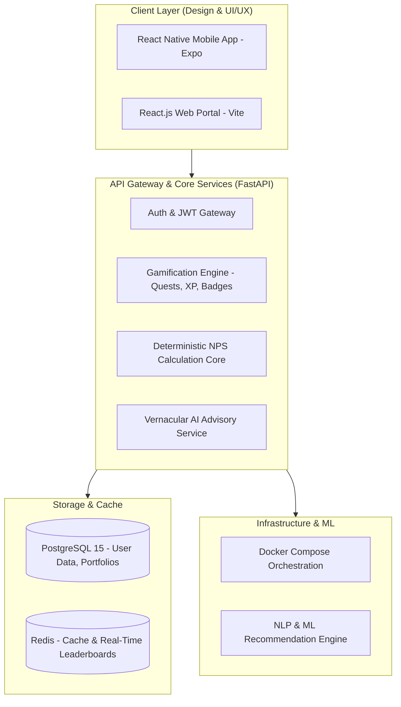

```text
 ╔═══════════════════════════════════════════════════════════════════════════════════════╗
 ║  ____                 _              ___                  _                           ║
 ║ |  _ \ ___ _ __  ___ (_) ___  _ __  / _ \ _   _  ___  ___| |_                         ║
 ║ | |_) / _ \ '_ \/ __|| |/ _ \| '_ \| | | | | | |/ _ \/ __| __|                        ║
 ║ |  __/  __/ | | \__ \| | (_) | | | | |_| | |_| |  __/\__ \ |_                         ║
 ║ |_|   \___|_| |_|___/|_|\___/|_| |_|\__\_\\__,_|\___||___/\__|                         ║
 ║                                                                                       ║
 ║   [★] ALL INDIA RANK #2   ::   PFRDA NATIONAL HACKATHON WINNER 2026                   ║
 ║   [⚔] GTM RETENTION ENGINE ::   VERNACULAR VOICE AI × DETERMINISTIC NPS MATH          ║
 ╚═══════════════════════════════════════════════════════════════════════════════════════╝
```

<div align="center">

[](https://github.com/ShivamRaut1610/PensionQuest)
[](https://fastapi.tiangolo.com)
[-61DAFB?style=for-the-badge&logo=react)](https://reactnative.dev)
[](https://www.postgresql.org)
[](https://www.docker.com)
[](LICENSE)

</div>

```text
 ┌─[ PIXEL STATUS HUD ]─────────────────────────────────────────────────────────────────┐
 │ HEARTBEAT : ● ONLINE        │ ARCH : MICROSERVICES │ REPO: PUBLIC                    │
 │ GTM FUNNEL: 92% DROP-OFF   ──(GAMIFIED QUESTS)──► 4.2x USER ACTIVATION LIFT         │
 │ ACCURACY  : 100% DETERMINISTIC CORE (ZERO FINANCIAL HALLUCINATIONS)                  │
 └──────────────────────────────────────────────────────────────────────────────────────┘
```

---

## 🎯 The GTM Problem & Product Design Thesis

**The Challenge:** Over **92% of India's working youth (under 35) lack an active National Pension System (NPS) account**. The root cause is not lack of money—it is **cognitive overload, intimidating bureaucratic forms, and severe financial jargon**.

**The GTM & Design Solution:** PensionQuest re-engineers retirement onboarding into a gamified RPG quest path. By combining **vernacular voice AI** (Hindi, Marathi, English) with **tactile compounding visualizers**, we turn 30-year projections into engaging daily progress loops.

```text
 [ Dry Government Forms ] ──(Friction: 92% Churn)──► ❌ Abandonment
            │
            ▼ (PensionQuest Redesign)
 [ RPG Quest Path ] ──► [ Vernacular Voice Coach ] ──► [ Instant Compounding ROI ] ──► 🚀 Active NPS Account
```

---

## 🏛️ System Architecture



---

## ⚡ Architectural Principles: *"Deterministic Math, Probabilistic Narration"*

```text
 ┌──────────────────────────────────────┐     ┌──────────────────────────────────────┐
 │     DETERMINISTIC MATH ENGINE        │     │     PROBABILISTIC VERNACULAR AI      │
 ├──────────────────────────────────────┤     ├──────────────────────────────────────┤
 │ • 100% Exact Python Math Core        │     │ • Natural Language Storytelling      │
 │ • NPS Tier-I & Tier-II Formulae      │ ──► │ • Multilingual (Hindi, Marathi, En)  │
 │ • Section 80CCD (1B) Tax Computations│     │ • Explains Annuity & Equity Ratios   │
 │ • Zero LLM Hallucinations            │     │ • Conversational Financial Guidance  │
 └──────────────────────────────────────┘     └──────────────────────────────────────┘
```

1. **Deterministic Core:** In financial software, LLMs must never compute pension corpus, annuity rates, or compounding yield. All mathematical simulations run in verified Python algorithms with 0% error margin.
2. **Vernacular AI Narrator:** The AI layer acts purely as a cultural storyteller, translating mathematical outputs into conversational vernacular analogies.
3. **Behavioral Gamification Loops:** Daily streaks, tiered achievement badges (*"Retirement Novice"* to *"Sovereign Sentinel"*), and scenario-based simulation choices.

---

## 📁 Repository Structure

```
pensionquest/
├── backend/                  # FastAPI Python 3.11 backend service
│   ├── app/
│   │   ├── api/v1/          # Endpoints (auth, quests, simulator, user)
│   │   ├── core/            # Configuration & security
│   │   ├── models/          # SQLAlchemy ORM models
│   │   ├── schemas/         # Pydantic v2 validation models
│   │   └── services/        # Business logic & deterministic math
│   └── tests/               # Pytest suite
├── frontend-mobile/          # React Native (Expo) cross-platform mobile application
├── frontend-web/             # React.js web dashboard with Obsidian UI
├── docs/                     # OpenAPI specifications, DB schemas & architectural notes
├── infra/                    # Dockerfile, docker-compose.yml & deployment configs
├── ml/                       # NLP models & vernacular prompt templates
├── execution_plan.md         # Hackathon execution milestones
├── HOW_TO_RUN.md             # Detailed deployment walkthrough
└── PensionQuest_Build_Guide.md # Comprehensive codebase manual
```

---

## 🚀 Quickstart Guide

### 1. Prerequisites
- Python >= 3.11
- Node.js >= 20.x
- Docker & Docker Compose
- PostgreSQL >= 15 & Redis >= 7.2 (or run via Docker)

### 2. Backend Setup
```bash
cd backend
python -m venv venv

# Windows:
.\venv\Scripts\activate
# Linux/macOS:
source venv/bin/activate

pip install -r requirements.txt
uvicorn app.main:app --reload --port 8000
```
*Interactive Swagger API documentation: `http://localhost:8000/docs`*

### 3. Mobile App (Expo)
```bash
cd frontend-mobile
npm install
npx expo start
```

### 4. Full Stack via Docker Compose
```bash
cd infra
docker-compose up -d --build
```

---

## 👥 Team PensionQuest

- **Shivam Raut** — *AI/ML Lead, GTM & System Architect* ([@ShivamRaut1610](https://github.com/ShivamRaut1610))
- **Aryan Tandale** — *Backend Lead & DevOps*
- **Pranjali Kale** — *Frontend Lead*
- **Vedika Sonnekar** — *Product Design & Content Lead*

---

## 📄 License
This project is open-source under the [MIT License](LICENSE).
