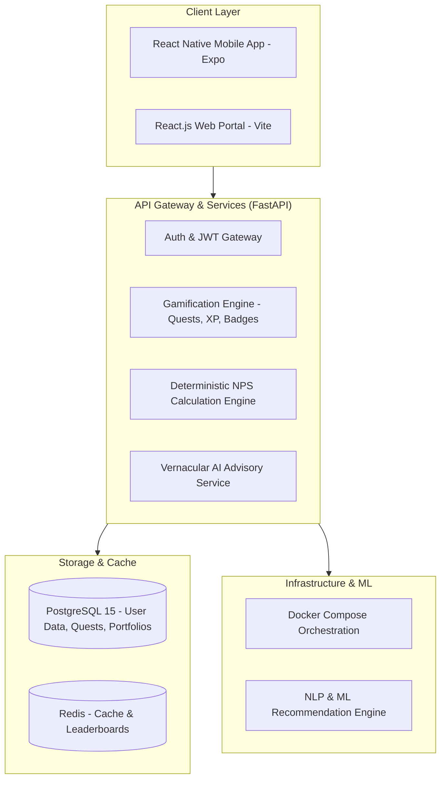

# PensionQuest 🎮
### Gamified NPS Awareness & Vernacular AI Engagement Platform
**All India Rank #2 Winner — PFRDA National Hackathon 2026**

[](https://github.com/ShivamRaut1610/PensionQuest)
[](https://fastapi.tiangolo.com)
[-61DAFB?style=for-the-badge&logo=react)](https://reactnative.dev)
[](https://www.postgresql.org)
[](https://www.docker.com)
[](LICENSE)

---

## 🌟 Overview

**PensionQuest** solves a critical national challenge identified by the **Pension Fund Regulatory and Development Authority (PFRDA)**: over **92% of India's working youth (under 35) lack an active National Pension System (NPS) account** due to information asymmetry, complex financial jargon, and cognitive detachment from retirement planning.

PensionQuest transforms NPS onboarding from a dull bureaucratic chore into an engaging, gamified journey tailored for Gen-Z and millennial workers, featuring:
1. **Interactive Quest System:** Bite-sized interactive scenarios where decisions directly impact long-term compounding simulations.
2. **Deterministic Financial Math:** Rigorous compounding and annuity math isolated from generative AI to ensure 100% mathematical accuracy with zero financial hallucination.
3. **Vernacular AI Companion:** Multilingual voice guidance (Hindi, Marathi, English) explaining complex tier allocations, tax exemptions (80CCD 1B), and pension payout mechanisms.

---

## 🏛️ System Architecture



---

## ⚡ Key Highlights & Engineering Features

- **Mathematical Engine:** Precise calculations for NPS Tier-I and Tier-II schemes, calculating Active Choice (Equity up to 75%, Corporate Debt, Govt Securities) vs. Auto Choice (Lifecycle Funds: LC75, LC50, LC25).
- **Gamification Mechanics:** Daily streaks, XP multiplier events, tiered badges (*"Retirement Novice"* to *"Sovereign Sovereign"*), and simulated life events (inflation spikes, market crashes).
- **Zero-Hallucination AI Architecture:** Follows the design philosophy *"Deterministic Math, Probabilistic Narration"*. The calculations are executed in validated Python core routines; LLM layers purely explain and narrate results in vernacular languages.
- **Production Ready:** Full Docker Compose setup containing backend API, database migrations, and Redis caching.

---

## 📁 Repository Structure

```
pensionquest/
├── backend/                  # FastAPI Python 3.11 backend service
│   ├── app/
│   │   ├── api/v1/          # Endpoints (auth, quests, calculator, user)
│   │   ├── core/            # Configuration & security
│   │   ├── models/          # SQLAlchemy ORM models
│   │   ├── schemas/         # Pydantic v2 validation models
│   │   └── services/        # Business logic & deterministic math
│   └── tests/               # Pytest suite
├── frontend-mobile/          # React Native (Expo) cross-platform mobile application
├── frontend-web/             # React.js web dashboard
├── docs/                     # OpenAPI specifications, DB schemas & architectural notes
├── infra/                    # Dockerfile, docker-compose.yml & deployment configs
├── ml/                       # NLP models & vernacular prompt templates
├── execution_plan.md         # Hackathon execution milestones
├── HOW_TO_RUN.md             # Detailed deployment walkthrough
└── PensionQuest_Build_Guide.md # Comprehensive codebase manual
```

---

## 🚀 Quickstart Guide

### 1. Prerequisites
- Python >= 3.11
- Node.js >= 20.x
- Docker & Docker Compose
- PostgreSQL >= 15 & Redis >= 7.2 (or run via Docker)

### 2. Backend Setup
```bash
cd backend
python -m venv venv
# Windows:
.\venv\Scripts\activate
# Linux/macOS:
source venv/bin/activate

pip install -r requirements.txt
uvicorn app.main:app --reload --port 8000
```
*API interactive documentation will be live at: `http://localhost:8000/docs`*

### 3. Mobile App (Expo)
```bash
cd frontend-mobile
npm install
npx expo start
```
*Scan the QR code with Expo Go on Android / iOS to run on a physical device or emulator.*

### 4. Full Stack via Docker Compose
```bash
cd infra
docker-compose up -d --build
```

---

## 👥 Team PensionQuest

- **Shivam Raut** — *AI/ML Lead & System Architect* ([@ShivamRaut1610](https://github.com/ShivamRaut1610))
- **Aryan Tandale** — *Backend Lead & DevOps*
- **Pranjali Kale** — *Frontend Lead*
- **Vedika Sonnekar** — *Product Design & Content Lead*

---

## 📄 License
This project is open-source under the [MIT License](LICENSE).
